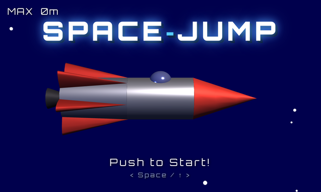
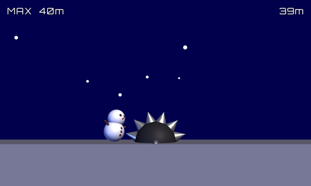

# SPACE JUMP

宇宙を舞台に、転がってくるトゲの球をジャンプでかわしながら距離を伸ばす、ブラウザで遊べる横スクロールのアクションゲームです。[Three.js](https://threejs.org/) で制作しました。

HTML ファイル 1 つで動作し、インストールやビルドは不要です。

**プレイ:** https://mimish0778.github.io/space-jump/

| タイトル画面 | プレイ画面 |
| --- | --- |
|  |  |

## 遊び方

1. タイトル画面で、スペースキー、`↑` キー、クリック、タップのいずれかを押すと、ロケットが発進してゲームが始まります。
2. 右からトゲの球が次々に転がってきます。同じ操作でジャンプして飛び越えてください。
3. トゲの球にぶつかるとゲームオーバーです。少しするとタイトル画面に戻ります。

進んだ距離（m）がスコアになります。最高記録は画面左上の `MAX` に表示されます。それまでの最高記録を更新すると、この表示が光ります。

## 操作方法

| 操作 | キーボード | マウス / タッチ |
| --- | --- | --- |
| ゲームを始める（タイトル画面） | `Space` / `↑` | クリック / タップ |
| ジャンプ（プレイ中） | `Space` / `↑` | クリック / タップ |

ジャンプは地面にいるときだけできます。空中でもう一度ジャンプすることはできません。

## ルール

- トゲの球が流れてくる速さは一定です。球と球の間隔は毎回ランダムに変わります。
- 距離は、プレイ中に 1 秒あたり 15m のペースで伸びます。
- 最高記録はページを開いている間だけ保持されます。ページを再読み込みすると 0 に戻ります。

## ローカルで動かす

```bash
git clone https://github.com/mimish0778/space-jump.git
```

クローンした `index.html` をブラウザで開くだけで遊べます。Three.js は CDN（cdnjs）から読み込むため、インターネットへの接続が必要です。

## 技術構成

- HTML / CSS / JavaScript（ES Modules）
- [Three.js](https://threejs.org/) r128（import map で cdnjs から読み込み）
- フォント: [Orbitron](https://fonts.google.com/specimen/Orbitron)（Google Fonts）

キャラクター、トゲの球、ロケットはすべて、球、円柱、円錐、箱といった基本的な形の組み合わせで作っています。3D の描画は WebGL のキャンバスで、スコアやタイトルの文字は HTML の要素で、画面切り替えのワープやフェードは 2D のキャンバスで描き、重ねて表示しています。画面は 700 x 420 の比率を保ったまま、ウィンドウの大きさに合わせて拡大・縮小します。

主な調整用の定数は `index.html` の先頭にまとめてあります。

| 定数 | 内容 |
| --- | --- |
| `SPIKE_SPEED` | トゲの球が流れてくる速さ |
| `SPIKE_MIN_GAP` / `SPIKE_MAX_GAP` | トゲの球どうしの間隔の最小値と最大値 |
| `JUMP_SPEED` / `GRAVITY` | ジャンプの初速と重力 |
| `TX_WARP_OUT_MS` / `TX_FADE_OUT_MS` | ワープとフェードの画面切り替えにかける時間 |

## ライセンス

[MIT License](LICENSE)
